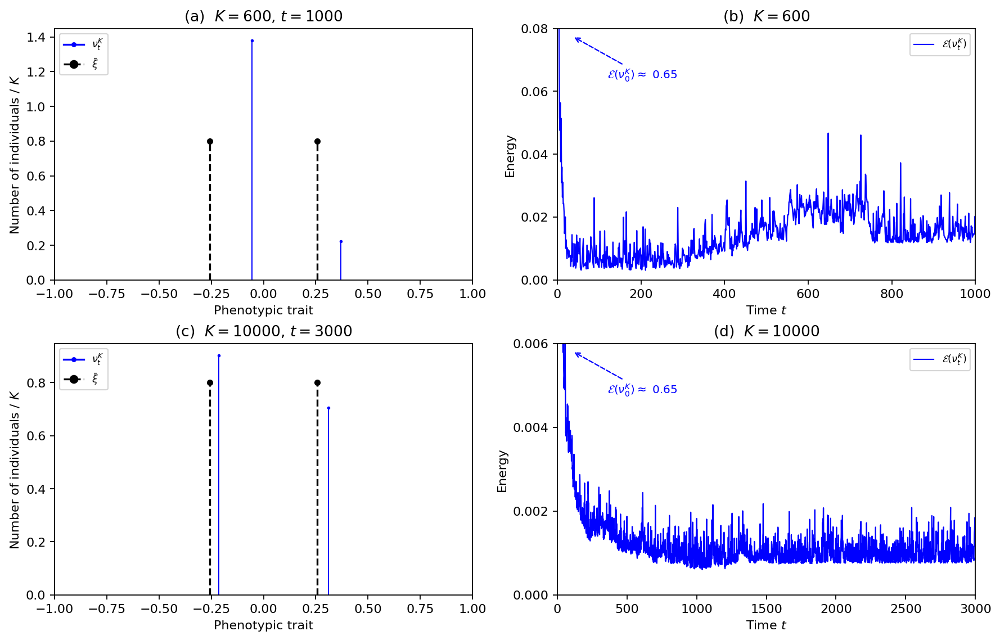

# Metastability of structured populations

Simulation code accompanying the manuscript **Metastability of a stochastic competitive model with large phenotypic diversity**, by Vincent Bansaye, Vianney de la Salle and Gaël Raoul (Section 4, manuscript dated 24 November 2026).

## Repository contents

- [Python simulation and plotting code](simulate.py)
- [Publication parameters and reproduction settings](PUBLICATION_PARAMETERS.md)
- [Interactive browser simulator](index.html) (open locally or deploy through GitHub Pages)
- [Browser instructions and deployment](WEB_README.md)
- [Example outputs, figures and CSV data](examples/README.md)
- [Numerical validation tests](test_simulate.py)



## Installation

Python 3.10 or later is recommended. In a terminal, from the repository directory:

```bash
python3 -m venv .venv
source .venv/bin/activate  # Windows PowerShell: .venv\Scripts\Activate.ps1
python -m pip install -r requirements.txt
```

## Run the experiments

```bash
# Small end-to-end test (not the article parameters)
python simulate.py --case all --quick --grid-size 101 --output output_quick

# Figure 1: single-atom ESD
python simulate.py --case mono

# Figure 2: two-atom ESD, both population sizes
python simulate.py --case dimorphic

# Both figures, with the default reproducible seeds
python simulate.py --case all
```

Use `python simulate.py --help` for all options. The first run compiles the exact jump simulator with Numba. Full experiments can be computationally expensive: no tau-leaping or diffusion approximation is used. The random seed defaults to 20261124 (the two dimorphic experiments use seed + 1 and seed + 2). Change it with `--seed 12345`. These are **new stochastic realizations**, not the archived trajectories in the manuscript: the original data files, random seeds and full driver were not supplied.

| Experiment | A | K | Final time | Population snapshots |
|---|---:|---:|---:|---|
| Figure 1 | 0.5 | 10000 | 5000 | 0, 50, 887, 3000 |
| Figure 2(a,b) | 1.5 | 600 | 1000 | 1000 |
| Figure 2(c,d) | 1.5 | 10000 | 3000 | 3000 |

## Model and implementation

The trait space is [-1,1]. The initial number of individuals is floor(K/2), each with an independent uniform trait. Each newborn inherits its parent's trait; there is no mutation. The limiting initial density is 1/4 on [-1,1], of total mass 1/2.

For an individual of trait x, the birth rate is b(x)=1+A-x². The death rate is 1 + (1/K) sum_j c(x,x_j), including the individual's own contribution, with c(x,y)=1/(1+(x-y)²). If n_i individuals share trait x_i, the two event rates are n_i b(x_i) and n_i [1 + sum_j c(x_i,x_j)n_j/K]. Each event changes n_i by ±1. The algorithm samples an exponential waiting time with parameter equal to the sum of all event rates, then chooses one event proportionally to its rate. Extinct traits are removed, since mutation is absent. This has the same CTMC law as the original competing-exponential algorithm. Competition is updated incrementally, and periodically recomputed to limit roundoff. Recording is on a prescribed time grid, using the right-continuous process; extinction is absorbing.

The deterministic comparison solves df/dt = f(x)[A-x² - integral c(x,y)f(y)dy] by midpoint quadrature (801 nodes by default) and scipy's adaptive DOP853 integrator (rtol=1e-7, atol=1e-10). Increase `--grid-size` to check spatial convergence; `--record-step` controls sampling of the energy, not the stochastic jumps or adaptive integration. The original deterministic discretization was not provided, so these are documented numerical choices. The Gaussian convolution with standard deviation 0.05 is only for visualization.

The equilibrium is A delta_0 for 0<A<=1. For 1<A<2 it is m(delta_{-z}+delta_z), with z=sqrt(-7+sqrt(17+32A))/4 and m=(13+16A-3sqrt(17+32A))/16. Energy is computed via equation (18): E(mu)=0.5<c[mu],mu> - <a,mu> + 0.5<c[ESD],ESD>. The stochastic routine evaluates this using the current competition vector, not a dense matrix. The energy can fluctuate in the stochastic model. For the deterministic solution it is nonincreasing, up to numerical errors.

## Output

The default output directory is `output/`. Each case has its own subdirectory (`mono`, `dimorphic_K600`, `dimorphic_K10000`). Results include:

- `empirical.csv`: original trait positions and empirical masses at the snapshot times, including zeros for extinct traits; columns `traits,t0,t50,t887,t3000` in the monomorphic case.
- `deterministic.csv`: midpoint grid and deterministic density at the same snapshot times; first column `x`.
- `energy.csv`: time, stochastic and deterministic energies, total stochastic mass, and number of surviving traits.
- `results.npz`: the above arrays plus all recorded deterministic densities and integer snapshot counts.
- `parameters.json`: parameters and seed used for the run.
- Individual snapshot and energy plots in PDF and PNG formats. Combined `figure_1.pdf` and `figure_2.pdf` (and PNG versions) are written at the output root.

The figures follow the supplied TikZ conventions (blue empirical measure, red deterministic density, dashed black ESD; dual axes where needed). Axis limits adapt to the new stochastic realization, except the energy panel of Figure 1 ([0,0.005]) and the two energy panels of Figure 2 ([0,0.08] for K=600 and [0,0.006] for K=10000), which retain the manuscript's zoom in full-scale runs. Initial energy outside the displayed range is indicated separately. Figure 2(d) uses the simulated time interval [0,3000], consistent with the caption (the manuscript's plotted axis extends to 5000). Standalone dimorphic energy plots retain their full range. Vertical markers use the newly computed energies, not hard-coded values from the supplied TeX files. The time 887 follows the manuscript (one original TeX marker was at 886). The CSV headers match the supplied TeX table column conventions; to reuse those files, change the paths to the respective CSVs and update the hard-coded energy markers using the new data. The new Python figures require no LaTeX installation.

## Validation

```bash
python -m unittest test_simulate.py
```

Tests check ESD stationarity, direct energy versus incrementally calculated energy, deterministic energy decay, reproducibility, exact initial mass, absence of new traits and nonnegative counts. Full-scale simulations have not been claimed to reproduce the original curves pointwise.

## Attribution and license

The code is adapted from the supplied `Useful_functions.py` and the manuscript's numerical section. The original function used a global K, modified the initial counts in place, and recorded the state at an inconsistent event time; the replacement uses explicit K, independent arrays and correct holding times. The original ESD formulas and energy functional are retained. Choose a software license with the authors and relevant rights holders before public distribution; none is assigned here. Update the manuscript citation with the final DOI when available.

The default full-scale runs were also executed successfully during preparation: 74,920,948 exact jumps (monomorphic), 4,573,805 (dimorphic K=600), and 233,669,827 (dimorphic K=10000). All three unit tests passed. These checks are not a statistical validation over multiple seeds or a grid-convergence study.

## Interactive browser version

Open `index.html` in your browser or publish the root directory using GitHub Pages. See [WEB_README.md](WEB_README.md) for setup, numerical methods, parameters and limitations. The browser implementation is exploratory and independent of the Python solver.
